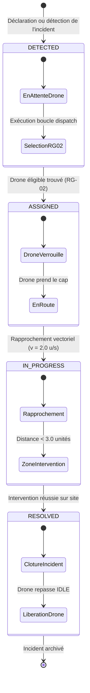

# Spécification Fonctionnelle — Panique à Bord

> **Système Opérationnel de Gestion de Crise et de Télémétrie de Drones**  
> *Référentiel Fonctionnel — Version 1.0.0 (Homologation Release #4)*  
> *Auteur : Greffier — Responsable Documentation Technique*

---

## 1. Vision Produit

Dans les contextes d'urgences industrielles, maritimes ou urbaines, la rapidité d'acheminement des premiers secours ou des vecteurs d'observation aérienne est déterminante. Les processus d'affectation manuelle génèrent des délais incompressibles et augmentent les risques d'erreur d'appréciation sous stress.

Le système **Panique à Bord** résout cette problématique en proposant un écosystème autonome combinant :
- Une **représentation spatiale continue** sur plan d'intervention 2D normalisé (`[0..100, 0..100]`).
- Un **moteur de dispatch prédictif** basé sur la géométrie euclidienne et la télémétrie énergétique de la flotte.
- Un **cockpit d'intervention cyber-crisis** fluide, sans framework lourd, offrant une vue unifiée aux décideurs de crise.
- Un **durcissement sécuritaire natif** garantissant l'intégrité de la chaîne de commandement face aux intrusions ou perturbations externes.

---

## 2. Catalogue des Règles de Gestion (RG)

### RG-01 : Niveaux de Criticité et Priorités Opérationnelles

Chaque événement survenu sur le secteur est qualifié par un indice de sévérité strict :

| Niveau | Sévérité | Impact Opérationnel | Délai Cible de Prise en Charge |
| :--- | :--- | :--- | :--- |
| **Niv 1** | `LOW` | Incident mineur ou anomalie de capteur sans danger immédiat. | Prise en charge différée si drones requis ailleurs. |
| **Niv 2** | `MEDIUM` | Dysfonctionnement matériel ou incident localisé sous contrôle. | Prise en charge dans les 30 secondes. |
| **Niv 3** | `HIGH` | Sinistre confirmé, risque de propagation rapide. | Prise en charge prioritaire immédiate. |
| **Niv 4** | `CRITICAL` | Danger vital, brèche majeure ou intrusion hostile. | Préemption absolue et alerte sonore/visuelle cockpit. |

---

### RG-02 : Algorithme de Dispatch et Proximité Géométrique

L'affectation automatique d'une unité de secours repose sur l'évaluation de la proximité spatiale couplée à un filtre énergétique d'admissibilité :

#### 1. Formule de calcul de distance euclidienne
Pour tout drone candidat $d$ de coordonnées $(x_d, y_d)$ et tout incident non assigné $i$ de coordonnées $(x_i, y_i)$ :
$$d(d, i) = \sqrt{(x_d - x_i)^2 + (y_d - y_i)^2}$$

#### 2. Critères d'admissibilité d'un drone
Un drone $d$ est considéré comme éligible pour une intervention si et seulement si :
1. $\text{Statut}(d) = \text{IDLE}$ (l'unité n'est pas déjà engagée sur une autre mission).
2. $\text{Batterie}(d) > 15\%$ (seuil minimal de réserve de sécurité pour vol et retour base).

#### 3. Règle de sélection
Pour chaque incident à l'état `DETECTED`, le système sélectionne le drone $d^*$ minimisant la distance :
$$d^* = \arg\min_{d \in \mathcal{D}_{\text{éligibles}}} d(d, i)$$
Le drone $d^*$ passe immédiatement à l'état `EN_ROUTE` avec pour cible l'incident $i$. L'incident $i$ passe à l'état `ASSIGNED`.

#### 4. Résolution d'incident et libération de l'unité
À chaque cycle d'horloge de la simulation ($\Delta t = 1.0\text{ s}$) :
- Le drone avance en direction de sa cible à la vitesse vectorielle de $v = 2.0\text{ unités/cycle}$.
- Dès que la distance séparant le drone de l'incident devient inférieure au rayon d'action d'intervention :
  $$\text{Distance}(d, i) < 3.0\text{ unités}$$
  L'incident est déclaré `RESOLVED` et le drone redevient immédiatement disponible au statut `IDLE`.

---

### RG-03 : Cycle de Vie des Incidents et Unités

Le cycle opérationnel d'un incident est synchronisé avec l'état de la flotte de drones selon la machine à états suivante :

#### Synchronisation des statuts Drone / Incident :

| Étape Opérationnelle | Statut de l'Incident | Statut du Drone Assigné | Action Système Associée |
| :--- | :--- | :--- | :--- |
| **Création** | `DETECTED` | N/A (aucun drone assigné) | Enregistrement de l'incident, vérification des bornes $[0..100]$. |
| **Assignation** | `ASSIGNED` | `EN_ROUTE` | Verrouillage du drone par `RG-02`, ciblage de l'identifiant incident. |
| **Transit** | `ASSIGNED` / `IN_PROGRESS` | `EN_ROUTE` | Déplacement incrémental selon vecteur de vitesse $v = 2.0$. |
| **Clôture** | `RESOLVED` | `IDLE` | Distance $< 3.0$ atteinte. Incident sécurisé, drone déverrouillé. |

---

### RG-04 : Protection Anti-Injection, Intégrité et Bornage Radar

Afin de préserver l'intégrité de la salle de commandement contre les actes de malveillance ou les défaillances de sondes externes, des contrôles stricts sont appliqués à chaque point d'entrée :

1. **Validation Stricte des Coordonnées Radar** :
   - Toute coordonnée cartésienne $X$ ou $Y$ doit être un nombre réel fini respectant la plage stricte :
     $$0.0 \le X \le 100.0 \quad \text{et} \quad 0.0 \le Y \le 100.0$$
   - Les valeurs hors limites ($<0$ ou $>100$), les types non numériques, les booléens, les `NaN` ou infinis sont rejetés sans ambiguïté avec un code `HTTP 400 Bad Request`.
2. **Assainissement Systématique XSS** :
   - Tous les champs textuels transmis par les opérateurs ou les capteurs (`titre`, `description`, `severite`, `nom`) sont filtrés via `html.escape()` avant tout stockage ou restitution JSON.
   - Les balises `<script>`, ``, `<iframe>`, `<svg>` ou attributs d'événements JavaScript sont neutralisés sous forme d'entités HTML.
3. **Plafonnement et Intégrité de la File Active** :
   - Le moteur garantit une file d'incidents cohérente et sérialisée à l'aide d'un verrou réentrant (`threading.RLock`) empêchant toute situation de concurrence (*race condition*).

---

## 3. Matrice de Couverture Fonctionnelle par Ticket GitHub

| Ticket | Intitulé & Périmètre | Règles Métier Associées | Composants & Fichiers | Statut Recette |
| :---: | :--- | :---: | :--- | :---: |
| **#1** | **[INIT] Socle serveur temps réel & Tableau de bord initial** - Serveur HTTP standard sans dépendance. - API `/api/state`, `/api/incidents`, `/api/docs`. - Tableau de bord HTML initial. | `RG-01` `RG-03` | `server.py` `static/index.html` (v1) `docs/README.md` | **Validé** *(Closed)* |
| **#2** | **[DESIGN] Refonte Cockpit Cyber-Crisis & Carte Radar HTML/CSS** - Interface Glassmorphism sombre `#060b16`. - Radar tactique en pur CSS `< 180` lignes. - Navigation par onglets (Cockpit vs Centre Doc). | `RG-01` `RG-02` | `static/index.html` (v2) `static/` | **Validé** *(Closed)* |
| **#3** | **[CORE] Moteur télémétrique temps réel, Dispatch automatique & Tests** - Algorithme RG-02 de distance euclidienne. - Déplacement vectoriel fluide et tick 1s. - 13 tests unitaires automatisés sous `unittest`. | `RG-01` `RG-02` `RG-03` | `core/engine.py` `tests/test_engine.py` `server.py` | **Validé** *(Closed)* |
| **#4** | **[RELEASE] Campagne QA/Chaos, Rapport de Tests & Documentation 360°** - Validation globale d'homologation. - Manuel Utilisateur, Doc Fonctionnelle, Doc Technique. - Rapport de Tests et d'audit Chaos. | `RG-01` `RG-02` `RG-03` `RG-04` | `docs/MANUEL_UTILISATEUR.md` `docs/DOC_FONCTIONNELLE.md` `docs/DOC_TECHNIQUE.md` `docs/RAPPORT_DE_TESTS.md` | **En validation** *(En cours)* |
| **#5** | **[BUG/SEC] Vulnérabilité Injection XSS & Validation Coordonnées** - Neutralisation failles XSS (SEC-01). - Rejet strict coordonnées hors bornes (CHAOS-02). - Enrichissement suite de tests unitaires. | `RG-04` | `server.py` `core/engine.py` `tests/test_engine.py` | **Validé** *(Closed)* |
