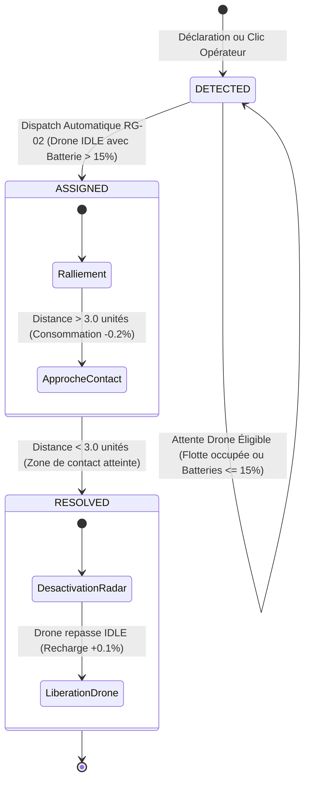

# 📘 Spécification Fonctionnelle Métier — Panique à Bord

> **Système** : Panique à Bord — Moteur Télémétrique & Supervision Autonome  
> **Auteur** : `Greffier` (`Model: flash`) — Usine Documentaire `living-docs-360`  
> **Référence** : Issue GitHub [#4](https://github.com/Yolepo/panique-a-bord/issues/4)  
> **Audience** : Product Owners, Responsables Métier, Coordinateurs de Sécurité, Architectes Logiciels  
> **Version** : 1.0.0 (Release Homologuée)  

---

## 1. 🌟 Vision Produit

### Contexte Opérationnel
Les sites industriels à haut risque (centrales de production, dépôts logistiques de matières sensibles, datacenters stratégiques) sont exposés à des incidents d'origine variée : défaillances techniques, intrusions malveillantes, départs de feu ou fuites chimiques. Dans ces contextes où chaque seconde compte, la dépendance à des interventions humaines directes induit des temps de latence préjudiciables et expose le personnel à des dangers critiques.

### Mission & Proposition de Valeur
**Panique à Bord** fournit une solution logicielle souveraine et autonome de détection, dispatching et neutralisation d'incidents par essaim de drones de surveillance en environnement clos ou semi-clos.  
Le système assure :
- **L'automatisation totale du dispatching tactique** sans intervention humaine obligatoire.
- **La transparence opérationnelle continue** par le biais d'un cockpit web temps réel léger et ultra-réactif.
- **La robustesse structurelle native** garantissant que le système ne s'effondre ni sous des tempêtes de données (bursts), ni face à des tentatives de compromission par injection de charges malveillantes.

---

## 2. 📑 Catalogue des Règles de Gestion (RG)

Le comportement du moteur de simulation et de gestion de crise est régi par quatre macro-règles métiers unifiées :

### 2.1 Règle RG-01 : Niveaux de Criticité et Priorité Opérationnelle
Tout incident détecté ou injecté sur la plateforme doit être caractérisé par un niveau de sévérité strict. Afin de garantir l'interopérabilité internationale et la rétrocompatibilité des interfaces, le système implémente un dictionnaire d'équivalences bilingue strict (`VALID_SEVERITIES`) :

| Sévérité Système (EN) | Libellé Métier (FR) | Niveau de Risque | Seuil de Vigilance | Couleur UI Radar |
| :---: | :---: | :---: | :---: | :---: |
| `CRITICAL` | `CRITIQUE` | Vital / Urgence Absolue | Intervention immédiate prioritaire | Cramoisi `#ff2a5f` (pulsé) |
| `HIGH` | `HAUTE` | Majeur | Risque d'escalade rapide | Cramoisi `#ff2a5f` (fixe) |
| `MEDIUM` | `MOYENNE` | Standard | Traitement nominal requis | Ambre `#ffb800` |
| `LOW` | `FAIBLE` | Contrôle / Mineur | Traitement en tâche de fond | Ambre clair `#ffb800` |

Toute requête d'incident transmettant une sévérité non déclarée dans cette nomenclature est immédiatement rejetée avec une exception métier `InvalidSeverityError` et un code HTTP `400 Bad Request`.

---

### 2.2 Règle RG-02 : Algorithme de Dispatch Euclidien & Cinématique

Lors de chaque cycle de simulation (cadencé toutes les 500 ms par le thread d'arrière-plan), le moteur procède à l'évaluation spatiale de l'ensemble des incidents en attente d'affectation (`DETECTED`).

#### 1. Formule de Distance Spatiale
La séparation géométrique entre un drone $D(x_d, y_d)$ et un incident $I(x_i, y_i)$ est calculée par la distance euclidienne canonique dans l'espace $\mathbb{R}^2$ borné par la grille $[0, 100] \times [0, 100]$ :

$$d(D, I) = \sqrt{(x_i - x_d)^2 + (y_i - y_d)^2}$$

En cas de coordonnées non résolubles ou d'anomalie de calcul, la fonction renvoie par sécurité une distance infinie ($+\infty$) pour écarter l'unité du calcul.

#### 2. Critères d'Éligibilité du Drone
Un drone $D$ est déclaré éligible à la prise en charge d'un incident si et seulement si l'ensemble des conditions suivantes est réuni :
1. **Disponibilité opérationnelle** : Son statut est strictement `IDLE`.
2. **Réserve énergétique sécurisée** : Son niveau de batterie est strictement supérieur au seuil d'exclusion :
$$\text{Batterie}(D) > 15\%$$

#### 3. Sélection du Meilleur Vecteur
Pour chaque incident à l'état `DETECTED`, le moteur calcule $d(D, I)$ pour l'ensemble des drones éligibles et sélectionne le drone $D^*$ minimisant la distance euclidienne :
$$D^* = \arg\min_{D \in \mathcal{D}_{\text{éligibles}}} d(D, I)$$

#### 4. Transition et Cinématique de Vol
Dès que l'affectation est prononcée :
- Le drone $D^*$ prend l'identifiant de cible $target\_id = I_{id}$ et passe au statut `EN_ROUTE`.
- L'incident $I$ passe au statut `ASSIGNED`.
- À chaque cycle (`tick`), si la distance $d$ est supérieure à la vitesse de déplacement ($v = 5.0$ unités/tick), la position du drone s'ajuste par décomposition vectorielle :
$$x_{k+1} = x_k + \frac{x_i - x_k}{d} \times v$$
$$y_{k+1} = y_k + \frac{y_i - y_k}{d} \times v$$
- La batterie du drone diminue de **0.2%** par pas de temps en vol.

#### 5. Seuil de Résolution au Contact
L'incident est déclaré neutralisé dès que la distance drone-incident devient strictement inférieure à la zone de capture opérationnelle :
$$d(D, I) < 3.0 \text{ unités}$$
À cet instant :
- L'incident passe au statut `RESOLVED`.
- Le drone libère sa cible (`target_id = None`), repasse au statut `IDLE`.
- Au repos, le drone amorce sa recharge d'énergie de **+0.1%** par pas de temps jusqu'au plafond de 100.0%.

---

### 2.3 Règle RG-03 : Cycle de Vie d'un Incident & Modélisation d'États

Le cycle de vie complet d'un incident est interconnecté à la cinématique du drone associé.

#### Synchronisation des États Incidents / Drones
| Étape | Statut Incident | Statut Drone | Dynamique Énergétique | Condition de Passage |
| :---: | :---: | :---: | :---: | :--- |
| **1. Détection** | `DETECTED` | `IDLE` | $+0.1\%$ / tick (recharge) | Injection manuelle ou auto |
| **2. Affectation** | `ASSIGNED` | `EN_ROUTE` | $-0.2\%$ / tick (en vol) | Élection du drone le plus proche (`RG-02`) |
| **3. Convergence** | `ASSIGNED` | `EN_ROUTE` | $-0.2\%$ / tick (en vol) | Déplacement vectoriel ($v = 5.0$) |
| **4. Neutralisation** | `RESOLVED` | `IDLE` | $+0.1\%$ / tick (recharge) | Distance au contact $< 3.0$ unités |

---

### 2.4 Règle RG-04 : Gardes-Fous de Sécurité & Protection de Charge

Faisant suite aux conclusions de l'audit de sécurité et de robustesse (Issue #5), le moteur applique quatre gardes-fous stricts :

1. **Assainissement XSS Systématique (`[SEC-01]`)** :
   - Tous les champs textuels (`titre`, `title`) soumis au moteur font l'objet d'un échappement HTML obligatoire via `html.escape(..., quote=True)`.
   - Une troncature défensive à 120 caractères est appliquée pour prévenir tout dépassement de mémoire tampon textuel.
2. **Validation des Coordonnées Cartésiennes (`[CHAOS-02]`)** :
   - Les coordonnées spatiales $x$ et $y$ doivent être des nombres finis réels satisfaisant la contrainte :
   $$0.0 \le x \le 100.0 \quad \text{et} \quad 0.0 \le y \le 100.0$$
   - Tout type non numérique (chaîne non parseable, booléen, valeur infinie $\pm\infty$ ou `NaN`) déclenche une exception `InvalidCoordinatesError` (HTTP `400 Bad Request`).
3. **Contrôle Strict de la Nomenclature de Sévérité (`[CHAOS-02]`)** :
   - Seuls les libellés autorisés dans `VALID_SEVERITIES` sont admis. Tout écart lève `InvalidSeverityError` (HTTP `400 Bad Request`).
4. **Plafonnement de File Active Anti-Déni de Service (`[CHAOS-03]`)** :
   - Le volume cumulé d'incidents non résolus (`statut != 'RESOLVED'`) est borné par la constante :
   $$\text{MAX\_ACTIVE\_INCIDENTS} = 10$$
   - Dès l'atteinte de ce seuil, toute nouvelle injection d'incident est immédiatement bloquée avec émission d'une exception `ActiveIncidentLimitError` et retour du code HTTP `429 Too Many Requests`.

---

## 3. 📊 Matrice de Couverture Fonctionnelle des Tickets GitHub (#1 à #5)

Le tableau suivant retrace la couverture intégrale du backlog opérationnel et des exigences fonctionnelles de la plateforme :

| N° Ticket | Titre de l'Issue | Type | Persona Responsable | Règles Métier Couvertes | Commits Associés | Statut de Validation |
| :---: | :--- | :---: | :---: | :---: | :---: | :---: |
| **#1** | `[INIT] Socle serveur temps réel & Tableau de bord initial` | Feat | `Cambouis` | Socle HTTP, endpoints `/api/state`, `/api/incidents`, `/api/docs` | [`0dafe3d`](https://github.com/Yolepo/panique-a-bord/commit/0dafe3d) | ✅ Approuvé par `Pinailleur` |
| **#2** | `[DESIGN] Refonte Cockpit Cyber-Crisis & Carte Radar` | UI/UX | `Gouache` | `RG-01`, Carte radar stylisée, Dark Mode, code couleur bilingue | [`91ec332`](https://github.com/Yolepo/panique-a-bord/commit/91ec332) | ✅ Approuvé par `Pinailleur` |
| **#3** | `[ENGINE] Moteur télémétrique temps réel, dispatch RG-02` | Core | `Cambouis` | `RG-01`, `RG-02`, boucle 500ms, dispatch euclidien, cinématique batterie | [`80c4414`](https://github.com/Yolepo/panique-a-bord/commit/80c4414) [`494f534`](https://github.com/Yolepo/panique-a-bord/commit/494f534) | ✅ Approuvé par `Pinailleur` |
| **#5** | `[SECURITY/CHAOS] Durcissement : Injection XSS & Radar` | Sec/Bug | `Videur` / `Cambouis` | `RG-04`, anti-XSS `[SEC-01]`, bornes `[CHAOS-02]`, DoS `[CHAOS-03]` | [`d244243`](https://github.com/Yolepo/panique-a-bord/commit/d244243) | ✅ Approuvé par `Pinailleur` |
| **#4** | `[RELEASE] Campagne QA/Chaos, Tests & Doc 360°` | Release | `Videur` / `Greffier` | Validation globale `RG-01` à `RG-04`, Usine documentaire 360° | Commit courant | 🟢 En cours de Release |
