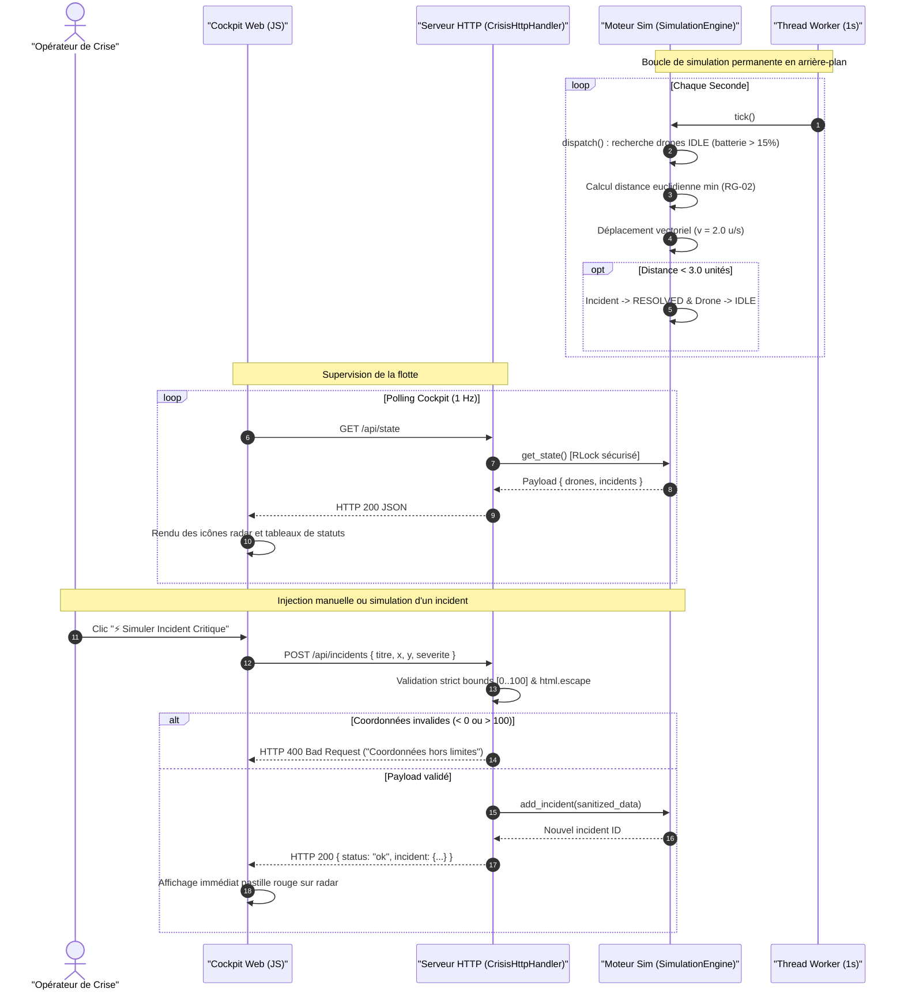

# Documentation Technique & Architecture — Panique à Bord

> **Système Opérationnel de Gestion de Crise et de Télémétrie de Drones**  
> *Référentiel Technique & Architecture — Version 1.0.0 (Homologation Release #4)*  
> *Auteur : Greffier — Responsable Documentation Technique*

---

## 1. Architecture Globale du Système

La plateforme **Panique à Bord** repose sur une architecture sobre, performante et sans dépendance tierce (*Zero-Dependency Stack*). Le système est entièrement propulsé par la bibliothèque standard de Python 3 et un client Web léger en pur HTML5/CSS3/JavaScript standard.

### Diagramme d'Architecture des Composants

```mermaid
flowchart TD
    subgraph Client["Navigateur Client (Mission Control Cockpit)"]
        UI["Interface Utilisateur (index.html)"]
        RadarUI["Carte Radar CSS Pure (Grille 100x100)"]
        DocUI["Centre Documentaire (Visionneuse Markdown)"]
        PollingLoop["Boucle de Polling JS (1 req/sec)"]
    end

    subgraph Server["Serveur HTTP Multithread (server.py)"]
        HTTPServer["ThreadingHTTPServer (:8080)"]
        HttpHandler["CrisisHttpHandler"]
        SecuritySanitizer["Module Durcissement & Anti-XSS (html.escape)"]
        BoundsValidator["Validateur de Coordonnées (validate_coordinate)"]
        DocsService["Service Fichiers Markdown (DOCS_DIR)"]
    end

    subgraph Core["Moteur de Télémétrie & Simulation (core/engine.py)"]
        Engine["SimulationEngine"]
        StateLock["Verrou de Concurrence (threading.RLock)"]
        SimLoop["Worker Télémétrique (simulation_worker - 1 tick/sec)"]
        DispatchModule["Algorithme de Dispatch RG-02 (Distance Euclidienne)"]
        VectorMovement["Module Déplacement Vectoriel & Résolution (< 3.0 u)"]
        FleetState["Entités en Mémoire (Drones & Incidents)"]
    end

    UI --> PollingLoop
    PollingLoop -->|GET /api/state| HttpHandler
    UI -->|POST /api/incidents| HttpHandler
    DocUI -->|GET /api/docs| HttpHandler
    UI --> RadarUI

    HttpHandler --> SecuritySanitizer
    HttpHandler --> BoundsValidator
    HttpHandler --> DocsService
    SecuritySanitizer --> Engine
    BoundsValidator --> Engine

    HTTPServer --> HttpHandler
    SimLoop -->|tick()| Engine
    Engine --> StateLock
    Engine --> DispatchModule
    Engine --> VectorMovement
    Engine --> FleetState
```

### Description des Composants Techniques
1. **Couche Présentation (`static/index.html`)** :
   - Interface monopage (*Single Page Application*) condensée en moins de 180 lignes de code.
   - Utilisation de CSS Glassmorphism et de gradients CSS natifs pour émuler le radar tactique.
   - Consommation asynchrone des flux JSON via l'API Fetch standard du navigateur.
2. **Couche Transport & Sécurité (`server.py`)** :
   - `ThreadingHTTPServer` : Serveur HTTP standard capable de traiter des connexions concurrentes de manière isolée.
   - `CrisisHttpHandler` : Routeur de requêtes REST et distributeur de fichiers statiques avec isolation des répertoires contre le *path traversal*.
   - Étage de filtrage amont : validation de type, bornage des coordonnées radar et échappement HTML systématique.
3. **Moteur Cœur de Simulation (`core/engine.py`)** :
   - `SimulationEngine` : Orchestrateur central thread-safe gérant le cycle de vie des drones (`Drone`) et des incidents (`Incident`).
   - `calculate_distance` : Fonction mathématique pure calculant la distance euclidienne $\sqrt{\Delta x^2 + \Delta y^2}$.
   - Thread d'arrière-plan autonome (`simulation_worker`) cadencé à 1.0 seconde garantissant le déplacement régulier et la résolution dynamique des missions.

---

## 2. Flux Temps Réel & Diagramme de Séquence

Le flux de données combine un cycle télémétrique serveur autonome et un modèle de synchronisation par scrutation client (*Client Polling*) :



---

## 3. Contrat des Endpoints de l'API REST

Tous les échanges de l'API utilisent l'encodage `UTF-8` et le type MIME `application/json`. Les en-têtes CORS (`Access-Control-Allow-Origin: *`) sont systématiquement appliqués.

### 3.1. `GET /api/state`
Retourne l'état télémétrique complet de la flotte de drones et des incidents enregistrés.

- **Méthode** : `GET`
- **Code de Succès** : `200 OK`
- **Exemple de Réponse** :
```json
{
  "drones": [
    {
      "id": "PAB-01",
      "nom": "PAB-01 Alpha",
      "name": "PAB-01 Alpha",
      "x": 20.0,
      "y": 25.0,
      "statut": "IDLE",
      "status": "IDLE",
      "batterie": 98,
      "battery": 98,
      "target_incident_id": null,
      "speed": 2.0
    }
  ],
  "incidents": [
    {
      "id": "INC-01",
      "titre": "Incendie Zone Portuaire",
      "title": "Incendie Zone Portuaire",
      "description": "",
      "x": 50.0,
      "y": 45.0,
      "severite": "HIGH",
      "severity": "HIGH",
      "statut": "DETECTED",
      "status": "DETECTED",
      "assigned_drone_id": null
    }
  ]
}
```

---

### 3.2. `POST /api/incidents`
Déclare un nouvel événement d'urgence sur la grille tactique. Sert également pour la simulation de crise déclenchée par le bouton rapide du Cockpit.

- **Méthode** : `POST`
- **En-têtes** : `Content-Type: application/json`
- **Corps de la requête (JSON Schema partiel)** :
```json
{
  "titre": "Alerte Critique Brèche Portuaire",
  "x": 55.4,
  "y": 40.2,
  "severite": "CRITICAL",
  "description": "Voie d'eau identifiée au quai 3"
}
```
- **Contraintes de validation** :
  - `x` : Nombre flottant obligatoire, compris strictement entre `0.0` et `100.0`.
  - `y` : Nombre flottant obligatoire, compris strictement entre `0.0` et `100.0`.
  - `titre` / `title` : Chaîne de caractères assainie automatiquement contre XSS.
  - `severite` / `severity` : `LOW` | `MEDIUM` | `HIGH` | `CRITICAL`.
- **Réponses HTTP** :
  - `200 OK` : Incident enregistré et prêt pour assignation.
    ```json
    {
      "status": "ok",
      "incident": {
        "id": "INC-03",
        "titre": "Alerte Critique Brèche Portuaire",
        "x": 55.4,
        "y": 40.2,
        "severite": "CRITICAL",
        "statut": "DETECTED",
        "description": "Voie d'eau identifiée au quai 3",
        "assigned_drone_id": null
      },
      "incidents": [ ... ]
    }
    ```
  - `400 Bad Request` : Erreur de formatage JSON ou coordonnées hors du plan d'intervention :
    ```json
    {
      "error": "Coordonnées hors limites [0..100]"
    }
    ```

---

### 3.3. `GET /api/docs`
Expose dynamiquement l'ensemble des référentiels documentaires Markdown présents dans le répertoire `docs/`.

- **Méthode** : `GET`
- **Code de Succès** : `200 OK`
- **Exemple de Réponse** :
```json
{
  "DOC_FONCTIONNELLE.md": "# Spécification Fonctionnelle...",
  "DOC_TECHNIQUE.md": "# Documentation Technique...",
  "MANUEL_UTILISATEUR.md": "# Manuel Utilisateur...",
  "RAPPORT_DE_TESTS.md": "# Rapport de Tests d'Homologation...",
  "README.md": "# Panique à Bord..."
}
```

---

### 3.4. Fichiers Statiques (`GET /` et `GET /static/*`)
- Sert `static/index.html` pour la racine `/` et `index.html`.
- Sert les fichiers statiques de ressources (`.css`, `.js`, images) sous `/static/`.
- Protection renforcée anti-*Directory Traversal* interdisant l'échappement vers les répertoires parents.

---

## 4. Mesures de Sécurité & Durcissement (Hardening)

Conformément aux conclusions de l'audit d'intrusion et de chaos mené sous le Ticket #5, le système implémente une défense en profondeur à 3 niveaux :

```
             Flux Entrant JSON
                     │
                     ▼
       ┌───────────────────────────┐
       │ 1. Vérification du Schéma │ ➔ Rejet HTTP 400 si objet non valide
       └─────────────┬─────────────┘
                     ▼
       ┌───────────────────────────┐
       │ 2. Bornage strict Radar   │ ➔ Rejet HTTP 400 si x, y ∉ [0.0..100.0]
       │    (validate_coordinate)  │    ou si types non finis / NaN / inf
       └─────────────┬─────────────┘
                     ▼
       ┌───────────────────────────┐
       │ 3. Assainissement XSS     │ ➔ Échappement html.escape sur titre,
       │    (html.escape)          │    description, sévérité
       └─────────────┬─────────────┘
                     ▼
            Stockage & Dispatch
```

### 4.1. Assainissement Contre les Injections XSS (`SEC-01`)
- **Problématique résolue** : Possibilité d'injecter des balises malveillantes (`<script>`, ``) dans les libellés d'incidents qui s'exécutaient dans le navigateur des opérateurs de crise.
- **Solution technique** : Application de `html.escape(html.unescape(str(val)))` sur l'ensemble des champs textuels (`titre`, `description`, `severite`, `nom`). Le stockage interne et l'API renvoient des entités HTML inoffensives (`&lt;script&gt;`).

### 4.2. Validation Stricte des Coordonnées Radar (`CHAOS-02`)
- **Problématique résolue** : Injection de coordonnées aberrantes (`x: -9999, y: 88888`), de valeurs booléennes ou de valeurs infinies corrompant la matrice radar et le calcul de distance euclidienne.
- **Solution technique** : Création de la fonction `validate_coordinate(val)` :
  - Contrôle des types : rejet immédiat de `None` et des booléens (`bool` est une sous-classe de `int` en Python).
  - Conversion contrôlée en `float` et vérification avec `math.isnan()` et `math.isinf()`.
  - Contrôle d'intervalle strict : $0.0 \le val \le 100.0$.
  - Levée d'exception `ValueError("Coordonnées hors limites [0..100]")` déclenchant une réponse `HTTP 400 Bad Request`.

### 4.3. Protection de l'Arborescence du Serveur Web
- Vérification stricte des chemins d'accès de fichiers dans `_serve_file` :
  ```python
  if STATIC_DIR.resolve() in target_path.parents or target_path == STATIC_DIR.resolve():
      self._serve_file(target_path)
  else:
      self.send_error(403, "Accès interdit")
  ```
- Empêche toute tentative d'attaque par traversée de répertoires (`../`, `%2e%2e%2f`).

---

## 5. Guide d'Installation, Exécution Locale et Tests

### 5.1. Prérequis Système
- **Système d'exploitation** : Linux, macOS ou Windows.
- **Interpréteur** : Python 3.10 ou supérieur.
- **Dépendances tierces** : Aucune (0 `pip install`). Tout fonctionne avec la bibliothèque standard Python (`http.server`, `json`, `math`, `threading`, `unittest`, `pathlib`).

### 5.2. Lancement du Serveur de Crise
Exécuter la commande suivante à la racine du dépôt :
```bash
python3 server.py
```

Le serveur s'initialise et affiche dans la console :
```text
🛰️ [SimulationEngine] Moteur télémétrique temps réel démarré (1 tick/sec)
🚀 [Panique à Bord] Serveur actif sur http://127.0.0.1:8080 (Host: 0.0.0.0)
```

Ouvrir l'application dans le navigateur sur :
```text
http://127.0.0.1:8080
```

### 5.3. Exécution de la Suite de Tests Automatisés
La validation de la télémétrie, des règles de gestion RG-02 et du durcissement de sécurité s'exécute via le framework natif `unittest` :

```bash
python3 -m unittest discover -s tests -v
```

**Résultats de la recette technique (13 tests unitaires) :**
- `test_calculate_distance` : Validation géométrique de la formule euclidienne.
- `test_initial_state` : Vérification des 4 drones initiaux et de leur charge nominale.
- `test_dispatch_rg02_nearest_drone` : Validation de l'assignation du drone le plus proche.
- `test_dispatch_rg02_battery_filter` : Exclusion des drones dont la batterie $\le 15\%$.
- `test_dispatch_busy_drone_ignored` : Préservation des unités déjà engagées (`EN_ROUTE`).
- `test_tick_vector_movement` : Progression fluide selon le vecteur de vitesse ($2.0$ u/s).
- `test_tick_resolution` : Clôture de l'incident et libération de l'unité au seuil de $3.0$ unités.
- `test_add_incident_dynamically` : Insertion dynamique via l'API.
- `test_xss_sanitization_incident` : Neutralisation des injections XSS sur création d'incident.
- `test_xss_sanitization_setitem` : Neutralisation des injections XSS sur modification attributaire.
- `test_coordinates_validation_valid` : Tolérance des coordonnées valides aux frontières $[0, 100]$.
- `test_coordinates_validation_out_of_bounds` : Rejet des valeurs hors bornes ($< 0$ ou $> 100$).
- `test_coordinates_validation_invalid_types` : Rejet des chaînes non numériques, booléens, `NaN` et infinis.
