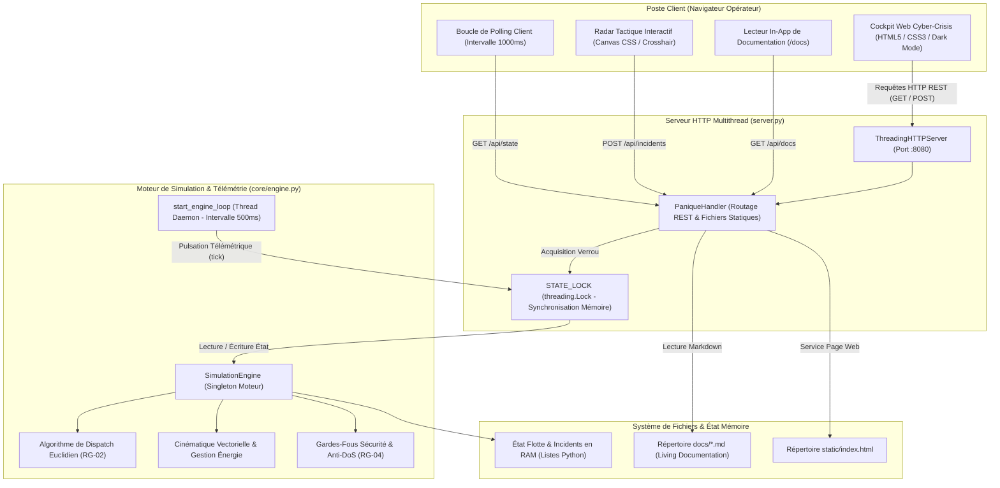
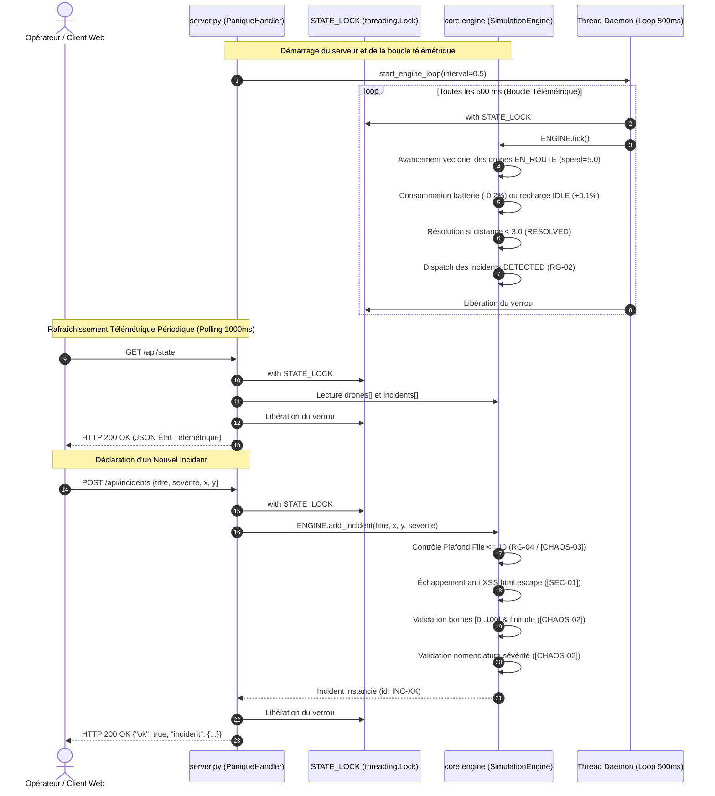

# 🛠️ Documentation Technique & Architecture Système — Panique à Bord

> **Système** : Panique à Bord — Mission Control & Moteur Télémétrique  
> **Auteur** : `Greffier` (`Model: flash`) — Usine Documentaire `living-docs-360`  
> **Référence** : Issue GitHub [#4](https://github.com/Yolepo/panique-a-bord/issues/4)  
> **Audience** : Architectes logiciels, Développeurs backend/frontend, Ingénieurs DevSecOps  
> **Version** : 1.0.0 (Release Homologuée)  

---

## 1. 🏗️ Architecture Globale des Composants

L'architecture de **Panique à Bord** repose sur un principe fondamental de souveraineté et de minimalisme opérationnel : **zéro dépendance externe** (aucune librairie tierce, aucun framework lourd, packaging Python 3 standard pur).



### Principes Clés d'Ingénierie
1. **Thread-Safety & Concurrence** : Le serveur HTTP traite chaque requête entrante sur un thread distinct (`ThreadingHTTPServer`). Pour prévenir toute condition de course (*race condition*) entre le thread d'arrière-plan de la simulation télémétrique et les requêtes HTTP, l'ensemble des mutations de l'état mémoire est protégé par un verrou d'exclusion mutuelle (`STATE_LOCK = threading.Lock()`).
2. **Dissociation Télémétrie / Affichage** : La boucle de cinématique tourne à une fréquence de **2 Hz (500 ms)** en arrière-plan, tandis que l'interface client interroge l'état à **1 Hz (1000 ms)**, assurant une parfaite fluidité sans engorger le réseau.
3. **Living Documentation Embarquée** : Le serveur expose dynamiquement le répertoire physique `docs/*.md` via `/api/docs`, garantissant que les opérateurs et auditeurs consultent toujours la documentation exacte correspondant à la version exécutée.

---

## 2. ⚡ Flux Temps Réel & API REST

Le diagramme de séquence ci-dessous illustre l'interaction temporelle entre le navigateur opérateur, le serveur HTTP, le verrou de synchronisation, le moteur télémétrique et la boucle daemon d'arrière-plan.



---

## 3. 📡 Contrat Détaillé des Endpoints API REST

Toutes les réponses de l'API sont formatées en JSON avec encodage `UTF-8` et contiennent l'en-tête `Access-Control-Allow-Origin: *`.

### 3.1 `GET /api/state`
Retourne l'état télémétrique complet de la flotte de drones et la liste des incidents opérationnels.

- **Méthode** : `GET`
- **Authentification** : Aucune
- **Code de succès** : `200 OK`
- **Exemple de réponse JSON** :
```json
{
  "drones": [
    {
      "id": "PAB-01",
      "nom": "PAB-01",
      "name": "PAB-01",
      "x": 20.0,
      "y": 30.0,
      "statut": "IDLE",
      "status": "IDLE",
      "batterie": 100.0,
      "battery": 100.0,
      "target_id": null
    }
  ],
  "incidents": [
    {
      "id": "INC-01",
      "titre": "Alerte intrusion nord",
      "title": "Alerte intrusion nord",
      "x": 25.0,
      "y": 35.0,
      "severite": "CRITIQUE",
      "severity": "CRITICAL",
      "statut": "ASSIGNED",
      "status": "ASSIGNED"
    }
  ]
}
```

---

### 3.2 `POST /api/incidents`
Injecte un nouvel incident opérationnel sur la grille. L'incident est immédiatement soumis aux validations de sécurité `RG-04`.

- **Méthode** : `POST`
- **Headers requis** : `Content-Type: application/json`
- **Schéma de la requête** :
```json
{
  "titre": "string (optionnel, max 120 car)",
  "title": "string (alias anglophone optionnel)",
  "x": "float | int (obligatoire, borne [0.0, 100.0])",
  "y": "float | int (obligatoire, borne [0.0, 100.0])",
  "severite": "string ('LOW'|'MEDIUM'|'HIGH'|'CRITICAL' ou FR)",
  "severity": "string (alias anglophone)"
}
```

- **Réponses Possibles** :
  - **`200 OK`** : Incident créé et inséré dans la file active.
    ```json
    {
      "ok": true,
      "incident": {
        "id": "INC-03",
        "titre": "Départ de feu secteur Est",
        "title": "Départ de feu secteur Est",
        "x": 45.2,
        "y": 80.1,
        "severite": "CRITIQUE",
        "severity": "CRITICAL",
        "statut": "DETECTED",
        "status": "DETECTED"
      }
    }
    ```
  - **`400 Bad Request`** : Coordonnées invalides, hors-grille, ou sévérité inconnue.
    ```json
    {
      "ok": false,
      "error": "Invalid coordinates: x and y must be within [0, 100]"
    }
    ```
  - **`429 Too Many Requests`** : Plafond d'incidents actifs (10) atteint (`RG-04`).
    ```json
    {
      "ok": false,
      "error": "Active incident queue limit reached (RG-04)"
    }
    ```

---

### 3.3 `POST /api/simulate`
Injecte automatiquement une grappe d'incidents aléatoires calibrés (`CRITICAL`, `MEDIUM`, `LOW`) avec des coordonnées comprises entre 10.0 et 90.0.

- **Méthode** : `POST`
- **Code de succès** : `200 OK`
- **Exemple de réponse** :
```json
{
  "ok": true,
  "generated": [
    {
      "id": "INC-04",
      "titre": "Alerte Panne Électrique",
      "x": 34.2,
      "y": 71.8,
      "severite": "CRITIQUE",
      "severity": "CRITICAL",
      "statut": "DETECTED"
    }
  ]
}
```

---

### 3.4 `GET /api/docs`
Expose la totalité des documentations Markdown hébergées dans le dossier `docs/` sous forme d'objet dictionnaire indexé par nom de fichier.

- **Méthode** : `GET`
- **Code de succès** : `200 OK`
- **Exemple de réponse** :
```json
{
  "docs": {
    "MANUEL_UTILISATEUR.md": "# 🚨 Manuel Utilisateur...",
    "DOC_FONCTIONNELLE.md": "# 📘 Spécification Fonctionnelle...",
    "DOC_TECHNIQUE.md": "# 🛠️ Documentation Technique...",
    "RAPPORT_DE_TESTS.md": "# 🛡️ Rapport d'Homologation..."
  }
}
```

---

## 4. 🛡️ Mesures de Durcissement Sécurité (Hardening)

À la suite de la campagne de tests d'intrusion menée lors de l'Issue #5 (`[BUG/SEC]`), plusieurs failles critiques ont été identifiées et corrigées dans le commit [`d244243`](https://github.com/Yolepo/panique-a-bord/commit/d244243cabfab4ba2f57c79303a86e97ca39cffd) :

### 4.1 Neutralisation des Injections XSS (`[SEC-01]`)
- **Vulnérabilité Initiale** : L'injection de charges telles que `` était stockée telle quelle et répercutée dans le DOM du client lors du rafraîchissement, permettant une exécution de script malveillant dans le contexte de session de l'opérateur.
- **Contre-mesure Implémentée** :
  ```python
  # core/engine.py
  raw_str = str(title).strip() if title is not None else ""
  clean_title = html.escape(raw_str[:120], quote=True)
  ```
  Le texte est systématiquement échappé selon les standards HTML5 et tronqué défensivement à 120 caractères.

### 4.2 Bornage et Validation Stricte des Coordonnées Radar (`[CHAOS-02]`)
- **Vulnérabilité Initiale** : L'envoi de coordonnées extrêmes (`x: -9999, y: 88888`), de valeurs infinies (`float('inf')`), ou de types inattendus (booléens, dictionnaires) désynchronisait le radar et faussait le calcul de distance euclidienne.
- **Contre-mesure Implémentée** :
  ```python
  # core/engine.py
  if isinstance(x, bool) or isinstance(y, bool):
      raise InvalidCoordinatesError("Invalid coordinates: x and y must be within [0, 100]")
  try:
      x_float = float(x)
      y_float = float(y)
  except (ValueError, TypeError):
      raise InvalidCoordinatesError("Invalid coordinates: x and y must be within [0, 100]")

  if not math.isfinite(x_float) or not math.isfinite(y_float):
      raise InvalidCoordinatesError("Invalid coordinates: x and y must be within [0, 100]")

  if not (0.0 <= x_float <= 100.0 and 0.0 <= y_float <= 100.0):
      raise InvalidCoordinatesError("Invalid coordinates: x and y must be within [0, 100]")
  ```
  Tout écart de typage ou débordement spatial en dehors de $[0.0, 100.0]$ est immédiatement sanctionné par un rejet HTTP `400 Bad Request`.

### 4.3 Plafonnement de File Anti-Déni de Service (`[CHAOS-03]` / `RG-04`)
- **Vulnérabilité Initiale** : L'envoi d'une rafale non filtrée de requêtes saturait la mémoire du serveur et paralysait la boucle de dispatch.
- **Contre-mesure Implémentée** :
  ```python
  # core/engine.py
  active_count = sum(
      1 for inc in self.incidents
      if inc.get("statut") != "RESOLVED" and inc.get("status") != "RESOLVED"
  )
  if active_count >= MAX_ACTIVE_INCIDENTS:
      raise ActiveIncidentLimitError("Active incident queue limit reached (RG-04)")
  ```
  La constante `MAX_ACTIVE_INCIDENTS = 10` plafonne le nombre de dossiers ouverts simultanément. Toute tentative excédentaire reçoit un code HTTP `429 Too Many Requests`.

---

## 5. 🚀 Guide d'Installation, Exécution Locale & Tests

### Prérequis Système
- **Environnement d'exécution** : Linux / macOS / Windows avec Python 3.8 ou supérieur.
- **Dépendances tierces** : **Aucune**. La plateforme fonctionne exclusivement avec la bibliothèque standard Python (`http.server`, `json`, `math`, `html`, `threading`, `unittest`).

### Démarrage du Serveur
Dans le répertoire racine du projet :
```bash
python3 server.py 8080
```
Le serveur écoute immédiatement sur `http://127.0.0.1:8080`. Ouvrez cette URL dans n'importe quel navigateur moderne pour accéder au Cockpit Mission Control.

### Exécution de la Suite de Tests Unitaires
Pour lancer l'ensemble des 11 tests unitaires validant les règles métier et la sécurité :
```bash
python3 -m unittest discover -s tests -v
```
Sortie attendue :
```text
Ran 11 tests in 0.000s
OK
```

### Exécution de la Sonde Chaos & Sécurité
Pour reproduire le banc de test d'intrusion automatisé de Videur :
```bash
python3 .agents/skills/chaos-and-test-runner/scripts/chaos_probe.py
```
Verdict attendu :
```text
🟢 VERDICT VIDEUR : 100% DES CONTRE-MESURES SÉCURITÉ & CHAOS VALIDÉES
```
