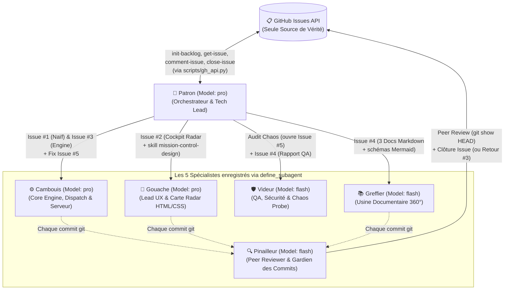

# 🎼 Plan de Démonstration : « L'Orchestre d'Agents Piloté par GitHub » (60–75 min)

> [!IMPORTANT]
> **Fil Conducteur & Philosophie de la Démo** :
> 1. **Départ Page Blanche ($T_0$)** : On part d'un répertoire vide et d'un dépôt GitHub `Yolepo/panique-a-bord` créé en direct via l'API REST GitHub.
> 2. **Le Ticket GitHub est la Seule Source de Vérité** : Grâce à [`backlog_specs.json`](.agents/skills/github-ticket-orchestrator/references/backlog_specs.json), `Patron` publie dès l'Acte I **4 Issues GitHub ultra-détaillées** (User Story, Persona responsable, Skill requis, Spécifications et Critères d'Acceptation). Ensuite, **vos prompts ne contiennent plus aucune spécification technique** : vous dites simplement à `Patron` quel numéro de ticket traiter, et il lit le cahier des charges directement sur GitHub via l'API (`get-issue`) !
> 3. **Routage Automatique des Modèles FinOps/Latence** : Chaque Persona embarque son modèle attitré (`pro` pour l'architecture, le design 60fps et l'algorithmique ; `flash` pour le Chaos Engineering et l'usine documentaire à haut débit), appliqué automatiquement par `Patron` lors de chaque `invoke_subagent`.

---

## 1. Situation de Base & Choix de l'Application Visuelle

### Le Départ à $T_0$ : La Page Blanche Absolue
* **Dépôt GitHub** : `Yolepo/panique-a-bord`, créé et initialisé en direct depuis le répertoire courant (`.`).
* **Pourquoi c'est fort devant le public** : Aucun code pré-écrit. Du serveur `server.py` au radar 60fps, aux tests unitaires, à l'audit sécurité et aux 4 documentations, tout naît en direct à partir des Issues GitHub.
* **Bonus interactif avec la salle** : Puisque `Patron` lit les spécifications via l'API GitHub (`get-issue`) au moment où vous lancez un prompt, vous pouvez modifier le texte d'une Issue directement sur GitHub.com avec le public avant de lancer l'agent !

### L'Application Cible : *« Panique à Bord »* (Cockpit Temps Réel Express)
* **Stack retenue** : **Python 3 standard (`server.py`, `core/engine.py`, `unittest`) + HTML5/CSS3/JS natif léger (< 180 lignes, sans Canvas complexe)**.
* **Pourquoi ce choix technique ?**
  * **Zéro dépendance bloquante** (aucun `npm install` ni compilation) : démarrage en **< 100 ms**.
  * **Génération UI ultra-rapide par `Gouache`** : carte radar en pur HTML/CSS (drones et incidents positionnés en `%` avec transition fluide) générée en une seule passe (~25 secondes au lieu de 8 minutes).
  * **Effet Avant / Après spectaculaire** :
    * **Issue #1 (sans le skill design)** : produit volontairement une interface HTML grise/claire très sobre (`<table>`) sur `http://127.0.0.1:8080`.
    * **Issue #2 (avec le skill `mission-control-design`)** : transforme instantanément l'écran en un Cockpit *Cyber-Crisis* sombre avec Carte Radar HTML/CSS et 2 onglets (`🎯 COCKPIT` et `📖 CENTRE DOCUMENTAIRE & QA`).

---

## 2. Le Comité des 6 Agents Pré-installés dans `.agents/personas/`

Pour maximiser la fluidité en direct, les **6 Personas** (`.agents/personas/*.md`), les **4 Skills** (`.agents/skills/*`) et `AGENTS.md` sont déjà en place dans le dossier `orchestre/`. Vous les parcourez à l'écran **pendant que les prompts s'exécutent** afin de commenter leur rôle et leurs garde-fous sans aucun temps mort :

| Persona | Fiche dans `orchestre/` | Modèle | Quand le parcourir à l'écran & Responsabilités |
| :--- | :--- | :--- | :--- |
| **`Patron`** | [`patron.md`](.agents/personas/patron.md) | **`pro`** | **Pendant le Prompt 1** : Orchestrateur & Tech Lead, ne code jamais seul, route les modèles `pro`/`flash` et impose la relecture par `Pinailleur`. |
| **`Cambouis`** | [`cambouis.md`](.agents/personas/cambouis.md) | **`pro`** | **Pendant le Prompt 2** : Développe `server.py` (Issue #1), `core/engine.py` + `tests/test_engine.py` (Issue #3) et corrige les failles (Issue #5). |
| **`Pinailleur`** | [`pinailleur.md`](.agents/personas/pinailleur.md) | **`flash`** | **Pendant les Prompts 2 & 3** : Relit chaque commit (`git show HEAD`), exige 1 retour sur l'Issue #3 (typage + docstring `RG-02`) avant de valider et fermer les tickets. |
| **`Gouache`** | [`gouache.md`](.agents/personas/gouache.md) | **`pro`** | **Pendant le Prompt 3** : Déploie le cockpit *Cyber-Crisis* en moins de 180 lignes avec carte radar HTML/CSS et 2 onglets (Issue #2). |
| **`Videur`** | [`videur.md`](.agents/personas/videur.md) | **`flash`** | **Pendant les Prompts 4 & 5** : Attaque le serveur avec `chaos_probe.py`, ouvre l'Issue #5 `[BUG/SEC]` sur GitHub, re-valide le correctif et rédige `RAPPORT_DE_TESTS.md`. |
| **`Greffier`** | [`greffier.md`](.agents/personas/greffier.md) | **`flash`** | **Pendant le Prompt 6** : Génère `MANUEL_UTILISATEUR.md`, `DOC_FONCTIONNELLE.md` et `DOC_TECHNIQUE.md` avec schémas Mermaid (Issue #4). |

---

## 3. Les 4 Skills du Comité (`.agents/skills/`)

1. 🔗 **`github-ticket-orchestrator`** ([`SKILL.md`](.agents/skills/github-ticket-orchestrator/SKILL.md)) — *Le Cœur du Workflow via l'API REST GitHub*
   * S'appuie sur le client Python sans dépendance [`scripts/gh_api.py`](.agents/skills/github-ticket-orchestrator/scripts/gh_api.py) (aucun besoin du CLI `gh`).
   * Embarque le cahier des charges complet des 4 tickets initiaux dans [`references/backlog_specs.json`](.agents/skills/github-ticket-orchestrator/references/backlog_specs.json).
   * Commandes clés : `create-repo`, `init-backlog`, `get-issue`, `create-issue`, `comment-issue`, `close-issue`.
2. 🎨 **`mission-control-design`** ([`SKILL.md`](.agents/skills/mission-control-design/SKILL.md)) — *L'Effet WOW Visuel Express (< 180 lignes)*
   * Définit les tokens CSS *Cyber-Crisis* (`#060b16`, `#00f0ff`, `#00ff9d`, `#ff2a5f`), le *Glassmorphism*, la Carte Radar 100 % HTML/CSS (drones et incidents positionnés en `%` sans Canvas complexe) et les 2 onglets (`🎯 COCKPIT`, `📖 CENTRE DOCUMENTAIRE & QA`).
3. 🛡️ **`chaos-and-test-runner`** ([`SKILL.md`](.agents/skills/chaos-and-test-runner/SKILL.md)) — *Audit Sécurité & Chaos Engineering*
   * Fournit la sonde [`scripts/chaos_probe.py`](.agents/skills/chaos-and-test-runner/scripts/chaos_probe.py) qui injecte un payload XSS (`[SEC-01]`), des coordonnées hors-radar `-9999, 88888` (`[CHAOS-02]`) et une rafale de surcharge (`[CHAOS-03]`).
   * Impose l'ouverture automatique d'un ticket `[BUG/SEC]` sur GitHub en cas d'échec, puis la génération de `docs/RAPPORT_DE_TESTS.md`.
4. 📖 **`living-docs-360`** ([`SKILL.md`](.agents/skills/living-docs-360/SKILL.md)) — *Usine Documentaire Tripartite*
   * Définit le plan exact et les schémas Mermaid obligatoires pour `MANUEL_UTILISATEUR.md`, `DOC_FONCTIONNELLE.md` (`RG-01` à `RG-04` + `stateDiagram-v2`) et `DOC_TECHNIQUE.md` (`flowchart` + `sequenceDiagram`).

---

## 4. Le Backlog des Tickets GitHub (`Yolepo/panique-a-bord`)

| Ticket GitHub | Origine | Titre | Persona (`Model`) & Peer Review | Livrable attendu en live |
| :--- | :--- | :--- | :--- | :--- |
| **Issue #1** | `init-backlog` (Prompt 1) | `[INIT] Socle serveur temps réel & Tableau de bord initial (Prototype Naïf)` | `Cambouis` (`pro`) $\rightarrow$ Peer Review `Pinailleur` (`flash`) | `server.py` (`:8080`) + `static/index.html` sobre/gris (pour le contraste Avant/Après), approuvé et clos par `Pinailleur`. |
| **Issue #2** | `init-backlog` (Prompt 1) | `[DESIGN] Refonte Cockpit Cyber-Crisis & Carte Radar HTML/CSS` | `Gouache` (`pro`) + `mission-control-design` $\rightarrow$ Peer Review `Pinailleur` (`flash`) | Cockpit *Mission Control* sombre (< 180 lignes), carte radar HTML/CSS fluide et 2 onglets, approuvé et clos par `Pinailleur`. |
| **Issue #3** | `init-backlog` (Prompt 1) | `[CORE] Moteur télémétrique temps réel, Dispatch automatique & Tests unitaires` | `Cambouis` (`pro`) $\leftrightarrow$ **1 retour live `Pinailleur` (`flash`)** | `core/engine.py` + `tests/test_engine.py`. **1er passage refusé** par `Pinailleur` (typage/docstring `RG-02`), corrigé par `Cambouis`, puis approuvé et clos ! |
| **Issue #4** | `init-backlog` (Prompt 1) | `[RELEASE] Campagne QA/Chaos, Rapport de Tests & Documentation 360°` | `Videur` (`flash`) + `Greffier` (`flash`) $\rightarrow$ Peer Review `Pinailleur` (`flash`) | `RAPPORT_DE_TESTS.md`, `MANUEL_UTILISATEUR.md`, `DOC_FONCTIONNELLE.md`, `DOC_TECHNIQUE.md`, revus et clos par `Pinailleur`. |
| **Issue #5** | **Créé en live par `Videur`** (Prompt 4) | `[BUG/SEC] Vulnérabilité Injection XSS & Validation Coordonnées hors-radar` | `Videur` (`flash`) $\rightarrow$ `Cambouis` (`pro`) $\rightarrow$ `Pinailleur` (`flash`) | Ouvert après l'attaque `chaos_probe.py`, corrigé par `Cambouis` (Prompt 5), re-validé par `Videur` et revu/clos par `Pinailleur`. |

---

## 5. Conducteur Minute par Minute (Aligné sur [`KIT_CHEF_DORCHESTRE.md`](KIT_CHEF_DORCHESTRE.md))

### ⏱️ Ouverture — La Page Blanche & La Vision (00:00 – 00:05 | 5 min)
* **Action** : Montrer que le répertoire `orchestre/` ne contient aucun code applicatif, uniquement `.agents/personas/`, `.agents/skills/` et `AGENTS.md`.
* **🎙️ Pitch Oral (Ton naturel / familier — ~2 min)** :
  > *« Salut à tous ! Bon, on a tous déjà joué avec un assistant IA : on lui balance un gros pavé dans le chat, il nous crache 400 lignes de code… et dès que le projet grossit un peu, c'est le bazar. Il oublie la moitié des consignes, il casse un truc à gauche quand il répare un truc à droite, et surtout : ça ne ressemble pas du tout à la façon dont on bosse dans une vraie équipe de dev.*
  >
  > *Regardez mon écran : là, il n'y a aucune ligne de code applicatif. Sur mon GitHub, le dépôt n'existe même pas encore. Et pourtant, pendant la démo, je ne vais pas coder une seule ligne de Python, de HTML ou de JS.*
  >
  > *À la place, j'ai préparé dans `.agents/` une petite équipe de 6 agents IA franchouillards. Chacun a sa fiche **Persona** en Markdown, ses **Skills**, et le modèle adapté à son job : du **Pro** pour le Patron à l'archi, Cambouis à l'algo moteur et Gouache au design graphique, et du **Flash** ultra-rapide pour Pinailleur qui relit chaque commit en Peer Review, Videur qui va attaquer l'appli et Greffier qui rédige la doc. On va parcourir leurs fiches ensemble pendant qu'ils bossent.*
  >
  > *Mais le vrai game-changer qu'on va voir aujourd'hui, c'est **comment on les pilote**. Dans la vraie vie, on pilote une équipe en créant des tickets et en faisant de la code review. Eh bien là, c'est exactement pareil : **notre seule source de vérité, ce sont les Issues GitHub**, et **aucun ticket ne peut être fermé tant que Pinailleur n'a pas relu le commit** ! Mon seul boulot pendant toute la démo, ça va être de dire à notre chef d'orchestre, le **Patron** : "Va lire le ticket #2 et le ticket #3 sur GitHub, et lance l'équipe". Allez, on lance le Prompt 1 ! »*

### ⏱️ Acte I — Enregistrement du Comité, Création du Dépôt & Publication du Backlog (00:05 – 00:12 | 7 min)
* **🎬 Prompt 1 (00:05)** :
  * Vous lancez directement le **Prompt 1** : `Patron` lit `AGENTS.md` et les 6 fiches de `.agents/personas/`, enregistre les 5 sous-agents via `define_subagent`, crée le dépôt public `Yolepo/panique-a-bord` via l'API REST (`gh_api.py create-repo`) et publie les 4 tickets détaillés (`gh_api.py init-backlog`).
  * **📖 Pendant l'exécution** : Vous ouvrez `AGENTS.md` et `.agents/personas/patron.md` dans l'IDE pour montrer au public comment sont définis les rôles et le routage `pro`/`flash`.
* **💥 Effet WOW #1** : Ouvrez `https://github.com/Yolepo/panique-a-bord/issues` devant le public et cliquez sur l'Issue #2 ou #3 pour montrer la richesse du cahier des charges publié automatiquement !

### ⏱️ Acte II — Du Prototype « Naïf » au Cockpit Radar + Le Retour de Peer Review en Direct (00:12 – 00:35 | 23 min)
* **🎬 Prompt 2 (00:12) — Traitement de l'Issue #1 (`[INIT]`) + 1re Peer Review** :
  * Vous demandez à `Patron` de lire l'Issue #1 sur GitHub (`get-issue`), de la faire réaliser par `Cambouis`, puis de faire relire le commit par `Pinailleur`.
  * **📖 Pendant l'exécution** : Parcourez `.agents/personas/cambouis.md` et `.agents/personas/pinailleur.md`.
  * **Action Présentateur** : Ouvrez `http://127.0.0.1:8080` en split-screen à droite pour montrer le prototype « naïf » (tableau HTML gris/clair volontairement basique, sans le skill design), et montrez sur GitHub le commentaire de validation de `Pinailleur` qui clôture l'Issue #1.
* **🎬 Prompt 3 (00:20) — Traitement en PARALLÈLE des Issues #2 (`[DESIGN]`) et #3 (`[CORE]`) + Le Retour de `Pinailleur`** :
  * Vous demandez à `Patron` de lire les Issues #2 et #3 sur GitHub (`get-issue`), de lancer leur implémentation **en parallèle** (`Gouache` + `Cambouis`), puis de soumettre chaque commit à `Pinailleur`.
  * **📖 Pendant l'exécution** : Parcourez `.agents/personas/gouache.md` et `.agents/skills/mission-control-design/SKILL.md`.
  * **💥 Effet WOW #2 (Double effet : Visuel + Vraie Code Review)** :
    1. Côté **Issue #2**, l'interface bascule en ~25 secondes en **Cockpit Cyber-Crisis** avec carte radar HTML/CSS et 4 drones animés ; `Pinailleur` inspecte le commit de `Gouache`, le valide et ferme l'Issue #2.
    2. Côté **Issue #3**, `Cambouis` livre `core/engine.py` et ses tests unitaires. Mais lors de sa relecture, **`Pinailleur` refuse de fermer le ticket au 1er passage** sur GitHub en demandant le typage Python et une docstring sur la formule `RG-02` ! `Patron` renvoie immédiatement `Cambouis` faire un 2e commit de retouche, que `Pinailleur` inspecte, approuve et clôture sous les yeux du public !

### ⏱️ Acte III — L'Attaque Chaos de `Videur`, le Bug #5 et l'Auto-Guérison (00:45 – 01:00 | 15 min)
* **🎬 Prompt 4 (00:45) — Audit Chaos & Ouverture Automatique de l'Issue #5 (`[BUG/SEC]`)** :
  * Vous demandez à `Patron` de mobiliser `Videur` (`Model: flash`) avec son skill `chaos-and-test-runner` contre `http://127.0.0.1:8080`.
  * **💥 Effet WOW #3** : `Videur` exécute `chaos_probe.py`, met en évidence la faille XSS (`[SEC-01]`) et les coordonnées hors-radar (`[CHAOS-02]`), et **crée de lui-même l'Issue #5 `[BUG/SEC]` sur GitHub** via l'API !
* **🎬 Prompt 5 (00:52) — Résolution, Re-validation Chaos & Peer Review de l'Issue #5 (`[BUG/SEC]`)** :
  * Vous demandez à `Patron` de faire corriger le ticket `[BUG/SEC]` par `Cambouis` (`pro`), de le faire re-valider par `Videur` (`flash`), puis de soumettre le commit de correctif à `Pinailleur` (`flash`).
  * `Cambouis` sécurise l'API (`html.escape` + validation stricte des bornes `[0..100]`) et ajoute les tests unitaires ; `Videur` relance `unittest` + `chaos_probe.py` (`100% VALIDÉ`) ; `Pinailleur` inspecte le commit (`git show HEAD`), publie son `✅ APPROVED` et clôture l'Issue #5 sur GitHub.

### ⏱️ Acte IV — Le Bouquet Final : Rapport QA, Documentation 360° & Dernière Peer Review (01:00 – 01:12 | 12 min)
* **🎬 Prompt 6 (01:00) — Traitement en PARALLÈLE de l'Issue #4 (`[RELEASE]`)** :
  * `Patron` consulte l'Issue #4 sur GitHub (`get-issue`) et lance simultanément **`Videur`** (`flash`) et **`Greffier`** (`flash`), avant de faire valider le commit documentaire par **`Pinailleur`** (`flash`) :
    1. 🧪 **`docs/RAPPORT_DE_TESTS.md`** *(par `Videur`)* : Matrice de couverture des Issues `#1` à `#5`, sortie `unittest`, comparatif Avant/Après `chaos_probe.py`.
    2. 📘 **`docs/MANUEL_UTILISATEUR.md`** *(par `Greffier`)* : Guide opérateur pas-à-pas, lecture du radar et FAQ.
    3. 📐 **`docs/DOC_FONCTIONNELLE.md`** *(par `Greffier`)* : Règles `RG-01` à `RG-04`, dispatch euclidien et `stateDiagram-v2` Mermaid.
    4. 🔧 **`docs/DOC_TECHNIQUE.md`** *(par `Greffier`)* : Architecture et `sequenceDiagram` Mermaid, API REST et sécurité.
* **💥 Effet WOW #4 (Clôture)** :
  * Vous cliquez sur l'onglet **`📖 CENTRE DOCUMENTAIRE & QA`** directement dans l'application `http://127.0.0.1:8080` pour parcourir les 4 livrables en direct.
  * Sur GitHub, les **5 Issues sont `Closed` (5 Closed / 0 Open)** avec la trace complète des Peer Reviews de `Pinailleur`, et tout le code + la documentation sont poussés sur `main`.
