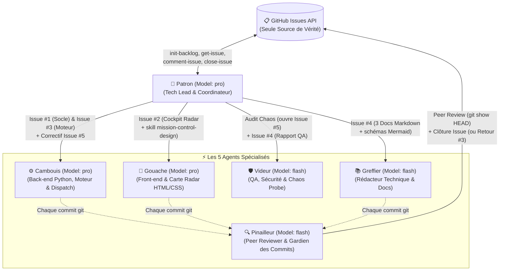
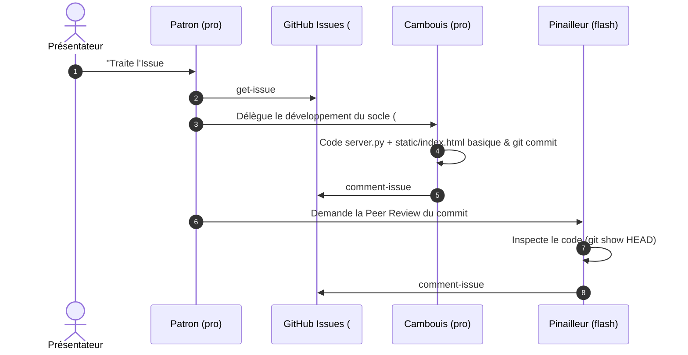
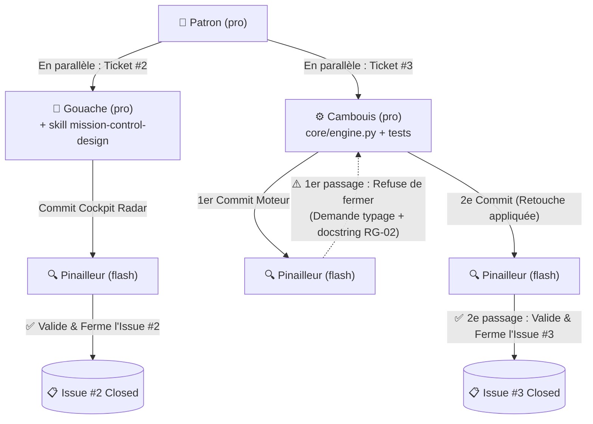
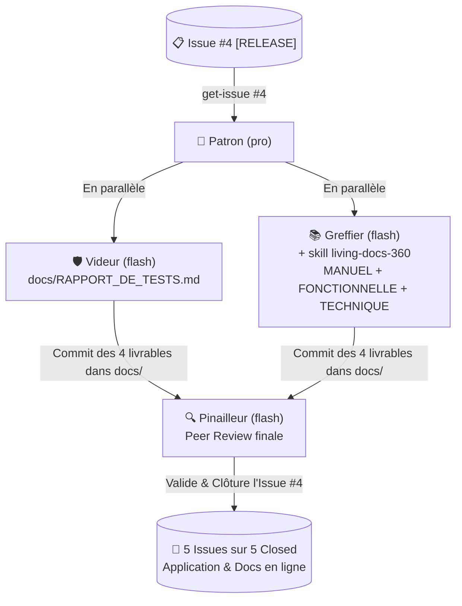

# Slide 1 — Le Comité des 6 Agents & L'Architecture Globale

| Agent | Modèle | Rôle | Responsabilité principale |
| :--- | :---: | :--- | :--- |
| **Patron** | `pro` | Tech Lead & Coordinateur | Lit les tickets sur GitHub, délègue en parallèle et fait relire chaque commit. |
| **Cambouis** | `pro` | Développeur Back-end Python | Développe `server.py`, le moteur `core/engine.py`, les tests unitaires et les correctifs. |
| **Gouache** | `pro` | Développeur Front-end | Déploie le cockpit *Cyber-Crisis* en moins de 180 lignes avec carte radar HTML/CSS. |
| **Pinailleur** | `flash` | Relecteur de Code | Inspecte chaque commit avec `git show HEAD`, exige des retouches et clôture les tickets. |
| **Videur** | `flash` | Ingénieur QA & Sécurité | Attaque le serveur avec `chaos_probe.py`, ouvre lui-même le bug #5 et valide le correctif. |
| **Greffier** | `flash` | Rédacteur Technique | Rédige les 3 manuels utilisateur, fonctionnel et technique avec schémas Mermaid. |

---

# Slide 2 — Interaction 1 : Initialisation & 1re Peer Review (Ticket #1)

* **Ce qu'on montre** :
  * Le prompt ne contient aucune consigne technique : **Patron** va lire l'Issue #1 directement sur GitHub.
  * **Cambouis** livre un prototype volontairement basique (sans skill design) et ne ferme pas son ticket.
  * **Pinailleur** vérifie le commit et clôture l'Issue #1.

---

# Slide 3 — Interaction 2 : Exécution Parallèle & Retour de Peer Review (Tickets #2 & #3)

* **Ce qu'on montre** :
  * **Parallélisme** : **Gouache** refait toute l'interface en Cockpit *Cyber-Crisis* pendant que **Cambouis** code l'algorithme de dispatch.
  * **Vrai aller-retour de Code Review** : Sur le ticket #3, **Pinailleur** refuse le 1er commit de **Cambouis** et poste un commentaire sur GitHub demandant le typage Python et la docstring `RG-02`. **Patron** renvoie **Cambouis** corriger dans un 2e commit avant que **Pinailleur** ne ferme le ticket.

---

# Slide 4 — Interaction 3 : Attaque Chaos, Auto-Bug & Auto-Guérison (Ticket #5)

```mermaid
flowchart LR
    Videur["🛡️ Videur (flash)\n+ chaos_probe.py"] -->|"1. Attaque : détecte XSS\n& coordonnées hors-radar"| Bug[("🚨 Crée lui-même\nl'Issue #5 [BUG/SEC]")]
    Bug -->|"2. Lecture du bug"| Patron["👔 Patron (pro)"]
    Patron -->|"3. Demande de correctif"| Cambouis["⚙️ Cambouis (pro)\nPatch + Tests unitaires"]
    Cambouis -->|"4. Commit du patch"| Pinailleur["🔍 Pinailleur (flash)\nPeer Review du commit"]
    Pinailleur -->|"5. Commit validé"| Videur2["🛡️ Videur (flash)\nContre-audit chaos_probe.py"]
    Videur2 -->|"6. 100% Vert : Ferme l'Issue #5"| Closed[("📋 Issue #5 Closed")]
```

* **Ce qu'on montre** :
  * **Ouverture autonome de ticket** : **Videur** attaque le serveur local, découvre 2 failles et crée de lui-même l'Issue #5 sur GitHub avec les preuves techniques.
  * **Chaîne de résolution complète** : **Cambouis** corrige $\rightarrow$ **Pinailleur** relit le commit $\rightarrow$ **Videur** relance ses sondes d'attaque et clôture le bug.

---

# Slide 5 — Interaction 4 : Release QA & Documentation 360° en Parallèle (Ticket #4)

* **Ce qu'on montre** :
  * **Usine documentaire en parallèle** : **Videur** synthétise la campagne QA pendant que **Greffier** inspecte le code réel pour générer les 3 documentations et leurs schémas Mermaid.
  * **Consultation immédiate** : Les 4 documents apparaissent directement dans le 2e onglet du Cockpit web, et **Pinailleur** clôture le dernier ticket sur GitHub.
